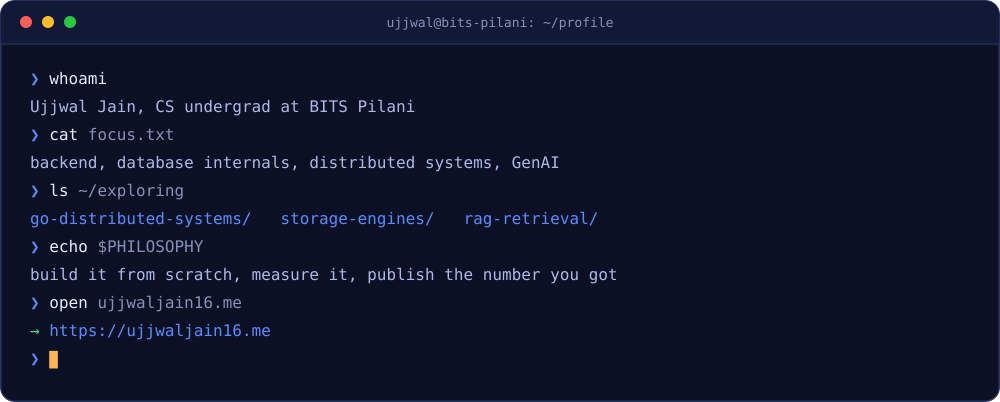
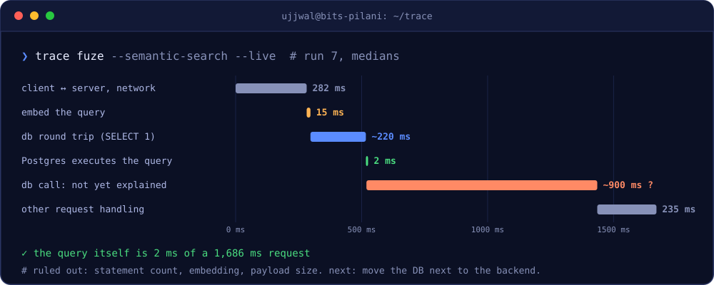

<a href="mailto:jainujjwal1609@gmail.com"><picture><source media="(prefers-color-scheme: light)" srcset="./assets/open-pill-light.svg" /></picture></a>

<picture><source media="(prefers-color-scheme: light)" srcset="./assets/hero-light.svg" /></picture>

<picture><source media="(prefers-color-scheme: light)" srcset="./assets/terminal-light.svg" /></picture>

<h3>measured, not claimed</h3>

<a href="https://www.ujjwaljain16.me/"><picture><source media="(prefers-color-scheme: light)" srcset="./assets/receipts-light.svg" /></picture></a>

<picture><source media="(prefers-color-scheme: light)" srcset="./assets/trace-light.svg" /></picture>

<h3>upstream: 15 merged PRs</h3>

<a href="https://github.com/pulls?q=is%3Apr+is%3Amerged+author%3AUjjwaljain16+-user%3AUjjwaljain16"><picture><source media="(prefers-color-scheme: light)" srcset="./assets/upstream-light.svg" /></picture></a>

<h3>writing</h3>

<a href="https://medium.com/@jainujjwal1609/why-postgresql-ignored-my-gist-index-until-i-rewrote-the-overlap-query-feb971225225"><b>Why PostgreSQL Ignored My GiST Index Until I Rewrote the Overlap Query</b></a> · Oct 2026 · PostgreSQL 
200,000 bookings, one “is this room free?” query, and a full table scan until the query changed shape.

<a href="https://medium.com/@jainujjwal1609/i-found-a-weird-number-on-instagram-and-it-turned-into-a-system-design-lesson-227d4fa533f2"><b>I Found a Weird Number on Instagram, and It Turned Into a System Design Lesson</b></a> · Sep 2026 · system design 
The profile showed one following count and the HTML another. Tracing why.

 · Jun 2026 · MLOps 
A Fashion-MNIST assignment that became a lesson in fault tolerance, identity design and performance.

<a href="https://medium.com/@jainujjwal1609/i-shipped-a-pwa-and-it-broke-in-ways-i-didnt-expect-here-s-what-i-wish-i-knew-a40fbd2ae99d"><b>I Shipped a PWA and It Broke in Ways I Didn’t Expect</b></a> · Mar 2026 · service workers 
Stale caches and the bug users swore was still there after the fix shipped.

<a href="https://medium.com/@jainujjwal1609/your-tabs-are-none-of-my-servers-business-building-vaulttabs-and-the-engineering-tradeoffs-behind-417565293e15"><b>Your Tabs Are None of My Server’s Business</b></a> · Feb 2026 · cryptography 
Building zero-knowledge tab sync: client-side cryptography, MV3 survival tactics and the tradeoffs.

<a href="https://medium.com/@jainujjwal1609/the-idea-fit-in-20-lines-making-it-correct-took-over-200-982e44dff61b"><b>The Idea Fit in 20 Lines. Making It Correct Took Over 200.</b></a> · Feb 2026 · testing 
Algorithmic complexity versus integration complexity, and why the second one is harder.

<a href="https://medium.com/@jainujjwal1609/when-turned-into-%C3%B0-a-deep-dive-into-base64-unicode-and-a-silent-javascript-bug-85be48bec797"><b>When 👍 Turned Into ð</b></a> · Feb 2026 · debugging 
UTF-8 bytes read as UTF-16: how a file name broke silently in stack traces, via Base64 and Unicode.

<h3>stack</h3>

<b>LANGUAGES</b> 
<picture><source media="(prefers-color-scheme: light)" srcset="https://skillicons.dev/icons?i=py,ts,js,java,go&theme=light" /></picture>

<b>BACKEND &amp; WEB</b> 
<picture><source media="(prefers-color-scheme: light)" srcset="https://skillicons.dev/icons?i=fastapi,flask,nodejs,express,nextjs,react,tailwind,spring&theme=light" /></picture>

<b>DATABASES</b> 
<picture><source media="(prefers-color-scheme: light)" srcset="https://skillicons.dev/icons?i=postgres,mysql,sqlite,mongodb,redis,supabase&theme=light" /></picture>

<b>AI &amp; RETRIEVAL</b> 

<b>DEVOPS &amp; CLOUD</b> 
<picture><source media="(prefers-color-scheme: light)" srcset="https://skillicons.dev/icons?i=docker,kubernetes,terraform,aws,githubactions,linux,git&theme=light" /></picture>

<b>TESTING &amp; OBSERVABILITY</b> 
<picture><source media="(prefers-color-scheme: light)" srcset="https://skillicons.dev/icons?i=vitest,jest,postman,prometheus,grafana&theme=light" /></picture>

  

<picture><source media="(prefers-color-scheme: light)" srcset="./assets/footer-light.svg" /></picture>

