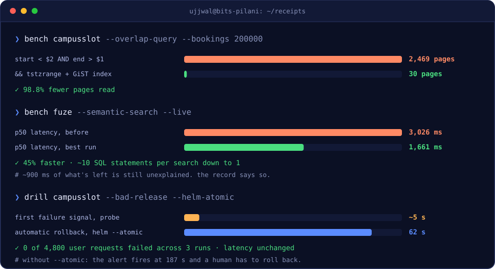
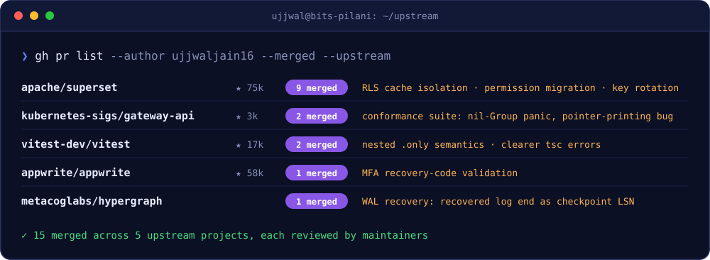

<h3>measured, not claimed</h3>

<h3>upstream: 15 merged PRs</h3>

<h3>stack</h3>

<b>LANGUAGES</b> 

<b>BACKEND &amp; WEB</b> 

<b>DATABASES</b> 

<b>AI &amp; RETRIEVAL</b> 

<b>DEVOPS &amp; CLOUD</b> 

<b>TESTING &amp; OBSERVABILITY</b> 

  

