 

  

  

<h3>measured, not claimed</h3>

  

<h3>open source: 13 merged PRs</h3>

  

<h3>technical skills</h3>

<table>
<tr>
<td align="right" valign="middle" nowrap><b>Languages</b></td>
<td align="left" valign="middle">

</td>
</tr>
<tr>
<td align="right" valign="middle" nowrap><b>Backend &amp; Web</b></td>
<td align="left" valign="middle">

</td>
</tr>
<tr>
<td align="right" valign="middle" nowrap><b>Databases</b></td>
<td align="left" valign="middle">

</td>
</tr>
<tr>
<td align="right" valign="middle" nowrap><b>AI &amp; Retrieval</b></td>
<td align="left" valign="middle">
    
</td>
</tr>
<tr>
<td align="right" valign="middle" nowrap><b>DevOps &amp; Cloud</b></td>
<td align="left" valign="middle">

</td>
</tr>
<tr>
<td align="right" valign="middle" nowrap><b>Testing &amp; Observability</b></td>
<td align="left" valign="middle">

</td>
</tr>
</table>

  

